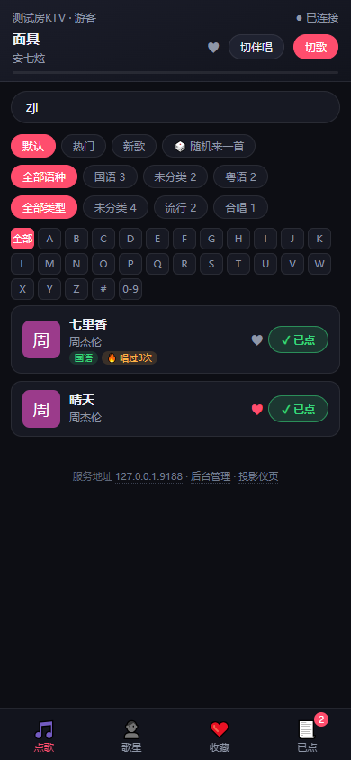
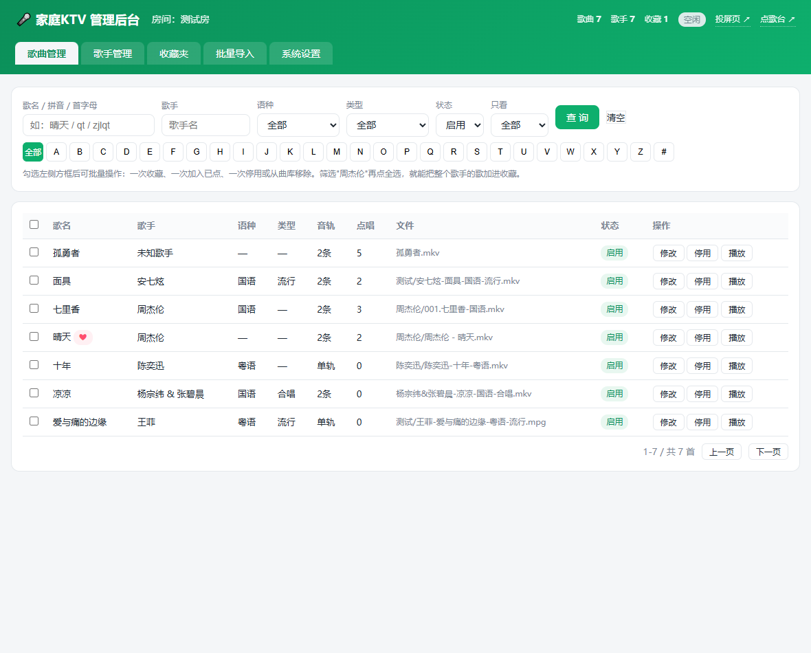
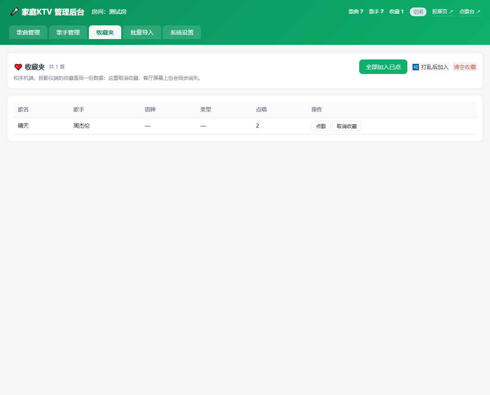
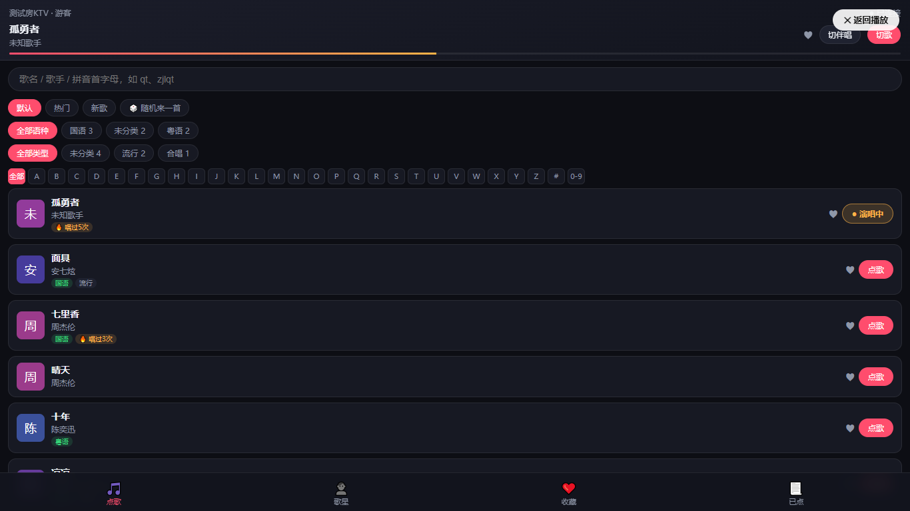

<div align="center">

# 🎤 家庭 KTV

**把客厅变成 KTV 包厢：飞牛 NAS 做歌库服务器，投影仪唱歌，手机扫码点歌**

   

</div>

---

## 这是个什么东西？

一句话：**在自己家里搭一套 KTV**。

- 你家里那台**飞牛 NAS** 负责存歌、管理歌库（装一个 fpk 应用就行）
- **投影仪**上装一个 APK，用遥控器像 KTV 一样点歌、切歌、切原唱伴唱
- 家人朋友的**手机**扫一下屏幕上的二维码，就能在手机上搜歌、点歌、抢麦
- 全程只在你家 **WiFi 内网**运行，不连外网、不用注册任何账号
- 哪怕你的 NAS 是 **J1900 这种十年前的弱 CPU** 也能跑——因为它**从不转码视频**（后面有原理说明）

## 界面长什么样？

| 手机点歌 | 手机预览（实时看投影仪画面） | 手机已点列表 |
|:---:|:---:|:---:|
|  |  |  |

| NAS 后台·歌曲管理（可批量勾选） | NAS 后台·收藏夹 | 网页播放页（电脑也能看） |
|:---:|:---:|:---:|
|  |  |  |

## 三个端各干什么？

```
┌──────────────┐   HTTP/SSE 实时同步   ┌──────────────────┐
│  飞牛 NAS     │◄────────────────────►│  投影仪            │
│  · 曲库扫描    │   全屏播放 KTV 视频    │  KTV Player APK   │
│  · 点歌 API   │   原唱/伴唱瞬时切换     │  （浏览器 /play 备用）│
│  · 按需音轨分离 │   显示点歌二维码       └────────┬─────────┘
│  · 后台管理    │                       │ 扫码 / 局域网
└──────────────┘                       ▼
                              ┌──────────────────┐
                              │  手机（多台同时）    │
                              │  H5 点歌台 /m/     │
                              └──────────────────┘
```

| 端 | 装什么 | 能干什么 |
|---|---|---|
| **NAS** | 一个 fpk 应用 | 存歌库、扫描建库、提供点歌接口、网页后台管理 |
| **投影仪** | 一个 APK | 全屏唱歌、遥控器点歌、切原唱/伴唱、显示点歌二维码 |
| **手机** | 扫码即用，什么都不用装 | 搜歌（支持拼音）、点歌、收藏、置顶/打乱已点、实时预览投影仪画面 |

## 快速开始（三步开唱）

### 第 1 步：NAS 装服务（fpk）

1. 从 [Releases](../../releases) 或 Actions 构建产物里拿到 `ktv_x.x.x_x86.fpk`
2. 把 fpk 文件复制到 NAS（网页文件管理器上传、或 SMB 共享复制都行）
3. 飞牛桌面 → **应用中心** → 右上角菜单 → **手动安装** → 选中 fpk 文件
4. 装完应用列表出现「家庭KTV」，状态显示「运行中」就成功了
5. 浏览器打开 `http://NAS的IP:9188` 能看到欢迎页 ✅

> 首次启动会自动扫描曲库目录，5000 首几分钟扫完；扫描期间已入库的歌就能点。

### 第 2 步：投影仪装 APK

1. 从 [Releases](../../releases) 下载 `HomeKTV-debug.apk`（也可在 **Actions** 页面每次构建的 Artifacts 里下载），拷到 U 盘
2. U 盘插投影仪 → 文件管理器 → 安装（提示「未知来源」时到 设置→安全 里允许一次）
3. 打开 App，默认地址已预填 `http://192.168.1.100:9188`——**改成你 NAS 的实际 IP**，点「连接」
4. 屏幕出现房间名和点歌二维码 ✅

### 第 3 步：手机扫码点歌

1. 用微信「扫一扫」扫投影仪屏幕上的二维码
2. 输入你的昵称（点歌时会显示「XX 点的」）
3. 搜歌 → 点「点歌」→ 投影仪上就开始放了 🎶

## 歌从哪来？（片源准备）

曲库就是 NAS 磁盘（或网盘挂载目录）里的**视频文件**，按下面的方式命名，系统会自动识别：

| 文件名 | 识别结果 |
|---|---|
| `周杰伦-晴天-国语-流行.mkv` | 歌手=周杰伦，歌名=晴天，国语，流行 |
| `杨宗纬&张碧晨-凉凉-国语-合唱.mkv` | 多歌手用 `&` 连接 |
| `老狼-同桌的你.mkv` | 语种/类型可省略 |
| `001.七里香-国语.mkv`、`[粤语]海阔天空.mp4` | 常见网上下载格式也兼容 |

> KTV 片源最好选**双音轨**的版本（一条原唱、一条伴唱），系统按音轨标题自动区分；
> 只有单音轨的歌也能唱，只是没有伴唱模式。
>
> ⚠️ **请使用自己拥有合法权利的片源**，本项目的测试片源不随仓库分发。

## 投影仪遥控器怎么按？

| 按键 | 单击 | 双击 | 长按 |
|---|---|---|---|
| **OK** | 暂停 / 继续 | — | — |
| **←** | （不动作，防误触） | 重唱 | ×2 快退 |
| **→** | （不动作，防误触） | 切下一首 | ×2 快进 |
| **↑** | 原唱 ⇄ 伴唱 | — | — |
| **↓** | 弹出操作菜单 | — | — |
| **功能键**（MENU） | 已点面板开关；点歌台里=切换大类 | — | — |
| **返回** | 播放页 ⇄ 点歌台（歌不停） | — | — |

## 工作原理（为什么弱 CPU 的 NAS 也能跑？）

普通转码方案是 NAS 把视频**整个重新编码**一遍——4 核 J1900 根本扛不住。

本项目完全不走这条路：

1. **视频流一个字节都不动**（`-c:v copy`，只换"包装盒"，类似把快递从纸箱换到塑料袋，货物本身不碰）
2. 唯一需要处理的是**音频**：老 KTV 片源的音轨是 MP2 编码，手机/电视都解不了，所以在**一首歌第一次被点唱时**才把音频转成 AAC（几秒钟），结果缓存下来永久复用
3. 投影仪 APK 更直接——**拉 NAS 上的原文件自己播**，切换原唱/伴唱只是本地换条音轨，瞬间完成
4. **点歌即预热**：歌一进队列，NAS 就在后台把下一首的准备工作做完，唱完这首下一首秒开

所以 NAS 的 CPU 负荷约等于零，同时挂 5000 首歌也毫无压力。

## 手机端更多玩法

- **拼音搜歌**：`zjl` 搜出周杰伦，`qt` 直达《晴天》（歌名大类只搜歌名，找歌手去「歌星」大类）
- **实时预览**：「预览」大类能看投影仪正在播的画面，去厨房做饭也不错过
- **收藏夹**：喜欢的歌点 ♥，下次「全部点唱」或「🔀 打乱」一次点一串
- **已点管理**：置顶、删除、打乱，谁先唱谁后唱你说了算

## 从源码构建

```bash
# 1. NAS 端 fpk（需要 Git Bash 环境）
cd server
node tools/fetch-runtime.mjs     # 下载 Node22 + ffmpeg 静态运行时（国内镜像）
node tools/build-fpk.mjs         # 产出 ../fpk/ktv_<版本>_x86.fpk

# 2. 投影仪 APK（需要 JDK17 + Android SDK + Gradle 8.7；或直接用本仓库的 GitHub Actions 云端编译）
cd android
gradle assembleDebug             # 产出 app/build/outputs/apk/debug/

# 3. 本地测试（先把几个双音轨测试视频放进 server/config.json 指向的目录）
cd server && node server.js
node tools/e2e-v2.mjs            # 31 项端到端验收
node tools/test-v3.mjs           # 22 项功能验收
node tools/check-ui-v120.mjs     # 手机端 UI 验收（需本机 Chrome）
```

## 项目结构

```
home-ktv/
├── fpk/               ★ NAS 端 fpk 打包工程（manifest / cmd / config / wizard）
├── server/            ★ NAS 端服务源码（零第三方依赖，Node 22 内置 SQLite）
│   ├── server.js            入口（端口 9188）
│   ├── src/                 扫描 / 文件名解析 / 离线拼音 / 播放状态机 / remux
│   ├── public/              播放页 /play、点歌台 /m、后台 /admin
│   └── tools/               打包脚本与全套自动化验收脚本
├── android/           ★ 投影仪 APK 源码（Kotlin + Media3，本地瞬时切音轨）
├── docs/              部署手册 / 逐条验收报告 / 需求确认书
└── .github/workflows/ push 自动编译 APK；打 v* 标签自动发 Release
```

> `server/config.example.json` 是配置模板，服务首次运行会自动生成实际配置。

## 常见问题（更多见 [docs/部署手册.md](docs/部署手册.md)）

| 现象 | 解决 |
|---|---|
| 某首歌播放失败 / 黑屏 | 大概率是 MP2 音轨，确认 NAS 端「播放兼容处理」已开启（默认开） |
| `.mpg` 在电脑网页上播不了 | 浏览器不支持 MPEG-2 视频，属正常；用投影仪 APK 播 |
| 切伴唱没反应 | 该片可能只有一条音轨，或音轨标题不规范；后台歌曲管理里可手动指定 |
| 网盘曲库扫描很慢 | 正常（网盘限速）；扫描在后台跑，不耽误点歌 |
| 想重建 fpk 但报错缺工具 | 先跑 `node tools/fetch-runtime.mjs` 下载运行时 |

## 免责声明

本项目仅供**学习交流与家庭自用**，请使用自己拥有合法权利的音视频片源；
请勿用于商业场所或公开放映。视频文件不随本仓库分发。

## License

[MIT](LICENSE) © 2026 lingtong7596
